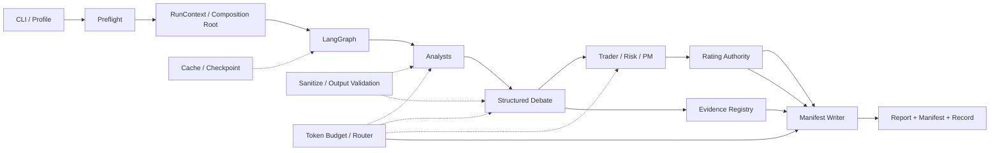

# 六部分整合计划书

## 1. 目的

六个 Part 并行开发后，需要在不互相等待、不互相破坏的前提下合成一个可运行、可验收的系统。本计划规定：

- 先冻结哪些契约；
- 各 Part 如何接入组合根；
- 按什么顺序集成；
- 用什么测试门禁判断“可以合并”；
- 出问题如何回退；
- 最终演示/验收需要哪些证据。

## 2. 整合原则

1. **契约先行**：第 1 周冻结 8 个共享契约；之后只允许向后兼容的字段新增。
2. **文件所有权清晰**：每个 Part 只改自己的目录；组合根由 Part 1 统一修改。
3. **Stub 优先**：任何 Part 不等待别人实现，先用 stub/fake 跑通自己的测试。
4. **Feature flag 隔离**：未完成/不稳定的 Part 默认关闭，不阻塞主流程。
5. **集成分支合并**：Part 分支先合到 `integration`，通过契约/集成测试后再合 `main`。
6. **证据驱动**：每次合并附测试输出、验收指标、OpenCode 会话摘要。

## 3. 共享契约与 Owner

| 契约 | Owner | 消费者 | 冻结时间 |
|---|---|---|---|
| `ProfileConfig` | Part 1 | Part 2/4/6 | 第 1 周周一 |
| `PreflightResult` | Part 1 | CLI/Part 3 | 第 1 周周一 |
| `DebateTurn` / `DebateTranscript` | Part 2 | Part 3 | 第 1 周周二 |
| `RunManifest` / `EvidenceRef` | Part 3 | Part 1/4/5/6 | 第 1 周周三 |
| `CacheKey` / `TTLPolicy` | Part 4 | Part 1/3 | 第 1 周周三 |
| `RatingResult` / `SecurityEvent` | Part 5 | Part 3 | 第 1 周周四 |
| `LLMCallEvent` | Part 6 | Part 3/4 | 第 1 周周四 |

**冻结规则**：

- 字段只能新增可选字段；删除/改类型必须 owner 批准 + 全组通知。
- 每个契约都有 `tests/contracts/test_*_contract.py`；契约测试失败 = 不能合并。
- 契约文件一人一个，禁止多人同时编辑。

## 4. 分支与合并策略

| 分支 | 用途 | 规则 |
|---|---|---|
| `main` | 可演示/可提交 | 只接受来自 `integration` 的 PR；必须通过全量测试 |
| `integration` | 日常集成 | Part 1 维护；各 Part 先合到这里 |
| `part-1/...` … `part-6/...` | 各 Part 开发 | 只改自己的目录；PR 到 `integration` |
| `contracts` | 第 1 周契约冻结 | 第 1 周末合并到 `main` 和 `integration` |

PR 要求：

- 标题：`[Part N] <简短说明>`
- 描述：改了哪些文件、对应需求 ID、测试命令/结果、是否影响契约。
- 评审：至少 1 名其他组员；涉及契约时 owner 必须评审。
- 不提交密钥、报告产物、缓存文件、个人 `.env`。

## 5. 数据流与组合根

关键点：

- **Part 1** 是组合根：创建 `RunContext`，按 feature flag 注入各 Part 的 adapter。
- **Part 5** 的 `sanitize()` 包住所有外部文本，再交给 Part 2/分析师。
- **Part 4** 的缓存/checkpoint 包住数据请求和图执行，不改变业务语义。
- **Part 6** 的 `LLMCallEvent` 由 provider adapter 产出，Part 3 汇总进 manifest。
- **Part 3** 是唯一写 manifest/报告/记录的地方；其他人只提供数据。

## 6. 集成顺序与里程碑

| 里程碑 | 时间 | 内容 | 通过标准 |
|---|---|---|---|
| **M0 契约冻结** | 第 1 周末 | 8 个契约 + stub + 契约测试 | `pytest tests/contracts` 全绿 |
| **M1 最小闭环** | 第 2 周末 | Part 1 + Part 5 + 现有图 | Quick 档位可跑；评级/安全生效；无 manifest 也可演示 |
| **M2 辩论 + 证据** | 第 3 周中 | Part 2 + Part 3 | 结构化辩论 + manifest + 带引用报告 |
| **M3 韧性** | 第 3 周末 | Part 4 | resume/缓存/降级；时点测试通过 |
| **M4 成本/延迟** | 第 4 周中 | Part 6 | 30 次基准 + token audit |
| **M5 最终验收** | 第 4 周末 | 全量 | 所有 Must + 可用的 Should 通过；演示完成 |

> 如果某 Part 延期，不阻塞里程碑：关闭对应 feature flag，用上一里程碑的可运行版本继续演示。

## 7. Feature Flag

在 `tradingagents/config` 或 `RunContext` 中提供：

| Flag | 默认 | 作用 | 关闭后的行为 |
|---|---|---|---|
| `enable_profiles` | on | 三档运行 | 使用旧默认配置 |
| `enable_preflight` | on | ticker/数据预检 | 直接进入图（旧行为） |
| `enable_structured_debate` | on | 结构化辩论 | 回退自由文本辩论 |
| `enable_evidence_manifest` | on | 引用 + manifest | 旧报告格式，无 manifest |
| `enable_cache_checkpoint` | on | 缓存/恢复 | 每次重新抓取/运行 |
| `enable_security` | on | 消毒/输出校验/脱敏 | 仅保留现有基础校验（不推荐） |
| `enable_cost_router` | on | token 预算/路由 | 不限制 token，只记录 |

**规则**：最终演示默认全开；如果某 Part 在演示前不稳定，关闭该 flag，并在演示中说明“已实现但本期默认关闭”，不要假装通过验收。

## 8. 测试门禁

| 阶段 | 命令 | 通过条件 |
|---|---|---|
| 契约 | `pytest tests/contracts` | 100% 通过 |
| 单元/需求 | `pytest tests/req` | 100% 通过（允许明确 skip 的 integration） |
| 集成 smoke | `pytest tests/integration/test_smoke.py` | Quick 端到端通过 |
| 安全 | `python scripts/security_regression.py` | 达到 Part 5 阈值 |
| 延迟 | `python scripts/bench_latency.py --profile quick` | Quick p95 达标（完整基准在 M5） |
| Token | `python scripts/token_audit.py --profile quick` | Quick p95 达标 |
| 回放 | `pytest tests/req/test_evidence_manifest.py::test_replay` | 100% 通过 |

CI 建议分两层：

- **每次 PR**：契约 + 单元 + 快速 smoke（不跑 30 次基准，避免慢/贵）。
- **每日/手动**：完整基准、安全回归、token audit、全量 integration。

## 9. 集成测试场景

| 场景 | 输入 | 断言 |
|---|---|---|
| Quick 正常 | NVDA / 近期交易日 / Quick | 有评级、报告、manifest；profile 正确 |
| 无效 ticker | `NOT_A_TICKER` | 预检失败；分析师调用 0；无 LLM token |
| 结构化辩论 | NVDA / Standard | transcript schema 100%；早停/最大轮数正确 |
| 证据链 | NVDA / Standard | 数字断言 100% 引用；manifest schema 通过 |
| 缓存/恢复 | 同一 ticker/date 跑两次；中途 kill 一次 | 第二次命中缓存；恢复不重复已完成 LLM 调用 |
| 时点完整性 | 历史日期 + 未来 fixtures | prompt 中未来数据 0 |
| 注入攻击 | 200 条红队 + 200 条正常 | 阻断率/误报率达阈值；评级不被改变 |
| 密钥泄露 | 合成 key 注入日志/错误/报告 | 扫描 0 findings |
| 超预算 | 人为降低 token 上限 | 被路由/阻断；不静默超支 |
| 评级异常 | 模型输出 “not a Sell” / 越界值 | 最终评级不变或 REVIEW；0 escapes |

## 10. 回退与故障处理

| 故障 | 立即动作 | 回退 | 证据 |
|---|---|---|---|
| 某 Part 契约测试失败 | 阻止合并到 `integration` | 保留上一版契约 | PR 日志 |
| 某 Part 集成后主流程崩溃 | 关闭对应 feature flag | 回退到 M1 最小闭环 | 集成日志 |
| 外部 provider 限流/延迟 | 降低基准频率；使用缓存/重试 | 只跑 Quick smoke | 基准/错误日志 |
| Reddit 403 | 保留 `<unavailable>` + 降置信度 | 关闭 social 数据源 | 运行报告 |
| 预算过紧导致质量下降 | 回滚预算/关闭 router | 使用上一版预算 | token/质量报告 |
| 演示前发现严重 bug | 关闭该 flag，保留可运行主流程 | 上一稳定 tag | 演示说明 |

## 11. 沟通节奏

- **周一 15 分钟**：契约同步；本周谁改组合根；是否有契约变更。
- **周三 15 分钟**：各 Part 进度/阻塞；只看验收命令是否通过。
- **周五 30 分钟**：合并到 `integration`；跑 smoke；更新 issue board。
- **每次 PR**：附测试输出 + 影响的 feature flag + 需求 ID。
- **每次人类干预**：记录到 `docs/agent-log.md`（课程 agentic SE 证据）。

## 12. Definition of Done（整合层）

- 8 个契约冻结且契约测试全绿。
- 六个 Part 的 Must 验收命令通过；Should 至少完成可演示部分。
- Quick/Standard/Deep 至少各跑一次成功；manifest + 报告 + 评级完整。
- 安全回归、密钥扫描、延迟/ token 基准达到阈值。
- 演示脚本可重复执行；失败场景（无效 ticker/注入/超预算）能演示降级。
- 代码提交、测试输出、基准报告、OpenCode 会话记录归档。
- 没有密钥、缓存、个人 `.env` 被提交。

## 13. 最终提交清单

- [ ] `docs/req/requirements-final.md`（需求基线）
- [ ] `docs/req/plans/part-1..6.md`（实现计划）
- [ ] `docs/req/plans/integration.md`（本文件）
- [ ] `docs/agent-log.md`（人类干预记录）
- [ ] `tests/contracts/`、`tests/req/`、`tests/security/`
- [ ] `scripts/bench_latency.py`、`scripts/token_audit.py`、`scripts/security_regression.py`
- [ ] 一次 Quick/Standard 运行的报告 + manifest + 评级记录
- [ ] 安全/延迟/token 验收报告
- [ ] 演示脚本与截图
