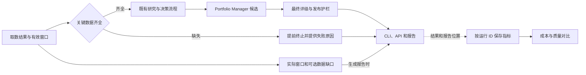

# TradingAgents 架构设计

## 1. 架构蓝图

以[需求表](../req/requirements.yaml)追踪验收，以六份已批准短记录落实具体规则。现有 LangGraph 的节点、边、执行顺序和辩论轮次保持不变。下图描述数据如何进入既有流程，以及运行结果如何发布。

| 需求 | 接入位置 | 数据与控制交接 |
| --- | --- | --- |
| [FR-03](../req/FR-03.md) | `cli/run.py`、`tradingagents/graph/trading_graph.py` 的运行边界，复用 `cli/stats_handler.py` 和 `tradingagents/graph/propagation.py` 的回调接线。 | CLI 与 `propagate()` 每次执行分配独立的应用运行 ID，共用一份统计回调。收集安全配置、阶段耗时、模型和工具调用、输入与输出 Token、可观测重试、结构化回退、数据状态和运行结果。报告实际写成后关联位置，并区分已保存、跳过和保存失败。数据状态仅作观测。 |
| [NFR-03](../req/NFR-03.md) | `tradingagents/agents/managers/portfolio_manager.py` 产出后，经 `tradingagents/agents/rating.py` 的统一护栏进入 CLI、API 和报告。 | 结构化结果和自由文本回退进入同一护栏。最终评级仅允许 `Buy`、`Overweight`、`Hold`、`Underweight`、`Sell`、`REVIEW`。自由文本须有明确的最终 `Rating:` 标签。判定前暂存阻断范围内的内容，出口只消费判定后的字段、消息和分节。 |
| [FR-02](../req/FR-02.md) | `tradingagents/agents/tools.py`、`tradingagents/dataflows/router.py`、直接取数路径与 `tradingagents/dataflows/vendors/yahoo/common.py`，在现有 Research Debate 入口校验结果。 | 一个逻辑数据请求携带一份剩余额度，跨供应商切换、Yahoo 重试及策略重试传递，每次实际后续尝试只扣一次。可选数据为个股新闻、FRED、Polymarket 和 sentiment。全球新闻和内幕交易沿用现有路由行为，技术指标故障自身不终止运行。关键数据缺失时在辩论前结束本次分析。 |
| [NFR-02](../req/NFR-02.md) | `tradingagents/dataflows/date_window.py`、供应商适配器与 `tradingagents/reporting.py`、`tradingagents/report_html.py`。 | 取数端在分析前校验记录可得时间。数据状态保留按来源裁剪的窗口、覆盖情况及最终结果。Markdown 和 HTML 共用一次生成的报告信息，报告头写指定 `as_of`、本次实际采用的数据窗口及同一个带时区的生成时刻。 |
| [FR-01](../req/FR-01.md) | Bull/Bear 研究节点、`tradingagents/agents/state.py`、Research Manager 和 Trader。 | 在原文本历史上记录发言角色和轮次。Research Manager 将结论、仍未解决的分歧和交接状态交给 Trader，沿用 `investment_plan` 文本及现有停止条件。分歧只记议题、双方观点和各自发言的轮次与角色。范围从分析师报告汇合后开始，到 Trader 收到交接为止。 |
| [NFR-01](../req/NFR-01.md) | 独立的对比环节，按运行 ID 只读 FR-03 指标记录。 | 核对标的、截止日期、分析师、模型和数据源配置，标明实际数据覆盖是否一致。以 Token 和调用次数作为采集数据，并通过记录中的报告位置追溯质量证据。 |

报告缺口来自最终取数状态，报告评级来自发布护栏。FR-02 的失败结果只发布原因说明，FR-03 的失败收尾仅持久化本次已采集的指标。硬 `REVIEW` 只采用 NFR-03 已判定的结果。

## 2. 架构决策

| 需求 | 已选做法 | 未采用的做法 | 理由 |
| --- | --- | --- | --- |
| FR-03 | 复用图执行回调，按 LangChain 单次调用 `run_id` 去重。在运行收尾独立保存指标。 | 分别在模型构造和图调用挂同一统计实例，或在 `record_decision()` 中写指标。 | CLI 和 Python API 可用同一计数口径。异常退出在没有最终决策时仍可留存指标，并保留成功路径的交易记忆语义。 |
| NFR-03 | 在 Portfolio Manager 后统一校验并处理目标字段，流式出口等判定后再发布相应内容。 | 只在 CLI 显示审核提示、只在 Markdown 清理，或把相关分析段落整篇替换。 | 同一候选可能进入实时消息、接口、分节报告和完整报告。统一发布边界可拦住提前发布及重复呈现，并保留原有分析文字。 |
| FR-02 | 按工具判断必需数据，研究辩论前校验。同一请求的三条重试路径共享额度。 | 按 `news_data` 整类降级、各层分别重试，或等生成交易计划后才处理关键数据缺失。 | 个股新闻、全球新闻与内幕交易的处理边界不同。共享额度使请求有界，先校验可避免缺数据时生成并传播交易内容。 |
| NFR-02 | 基于最终取数结果和实际覆盖生成报告元数据，一次取时供两种格式使用。 | 从 Agent 正文推测覆盖情况，或由 Markdown 和 HTML 各自取时。 | 取数端掌握有效窗口和结果，渲染端可使用同一时点与状态，避免把不可用写成空查询。 |
| FR-01 | 沿用原发言长文，只增加角色、轮次、分歧引用和交接状态。沿用研究经理的一次自由文本回退。 | 建独立争议挖掘流程、复制长文，或把回退文本的存在视为完整交接。 | 轻量记录足以复核双方观点。交接状态明确说明 Trader 拿到了哪些研究信息。 |
| NFR-01 | 先采集，再用同配置和同覆盖的正式样本对比，并同时检查成本和质量。 | 用单次补跑或耗时判通过，或把实际数据覆盖不同的样本混在一起。 | 样本、数据覆盖和质量共同决定成本比较是否成立，尤其要避免把因取数缺失而减少的调用误当成成本改善。 |

## 3. 不变量

| 必须成立 | 违反时怎么处理 |
| --- | --- |
| 每次运行的指标可用独立运行 ID 追溯。一次模型调用只记一笔，Token 输入和输出分别注明是否可用。指标只保存经校验的配置白名单与安全错误类别。 | 同一模型调用的重复开始或结束事件忽略重复部分。实际 `0` 原样保留，缺失写 `unavailable`，部分已知只作小计。SDK 内部重试标为「无法观测」。凭据及原始请求和异常文本排除出指标记录。失败时保存已收集指标，交易记忆仍由原成功路径处理。 |
| 关键数据为可用 OHLCV 或已验证快照中的任一路，加上 `as_of` 窗口内可用的利润表、资产负债表和现金流量表。 | 行情两路均不可用或任一张表缺失，在研究辩论前统一失败并记录具体原因。摘要和内幕交易不计入三表，技术指标不计入关键行情。未取得可验证数据的响应按缺失处理。失败出口不发布最终评级和交易内容。 |
| 同一个逻辑数据请求的供应商切换、Yahoo 重试和策略重试共享一个额度。 | 额度耗尽即停止发起后续数据请求，按原请求的关键性处理最终取数结果。模型的一次自由文本回退独立于数据预算。 |
| 数据进入计算、Agent 和报告前须在指定 `as_of` 时可知。可选缺口对应实际未取得的数据，只有确认完整覆盖且结果为空才写「未检索到」。 | 排除晚于截止时点才发生、披露或修订的数据。故障或覆盖不足写 `DATA_UNAVAILABLE` 或数据缺口。同一来源恢复并覆盖对应窗口后，去掉先前的缺口。Markdown 和 HTML 复用同一报告头信息。 |
| 显式硬 `REVIEW` 的最终评级为 `REVIEW`。自由文本与结构化输出遵守同一评级边界。 | 最终评级缺失、非法、冲突或无法解析时输出 `REVIEW`。`REVIEW` 时仅将 Trader 的 `action`、`entry_price`、`stop_loss`、`position_sizing` 及结尾交易方向置空或标为 `blocked`，将 Executive Summary 换成固定审核说明。各出口拦截这些内容的重复呈现，分析师报告、辩论长文和 Investment Thesis 原文保留。 |
| 未解决分歧能按轮次和角色追溯。研究结论与分歧记录均可确认时才能标为交接完整。 | 沿用一次自由文本回退，仍无法确认时交付不完整状态。结论缺失则明确标明，双方已记录的发言保留。该中间状态不触发最终 `REVIEW`。 |
| 正式对比中基线版和增强版各至少有 3 个不同的同条件运行 ID，两项阈值均由团队锁定且同时满足。 | 采集批次各 1 次只记 Token 和调用次数。数据覆盖不同的记录标记为不可作同条件对比。样本不足或任一阈值仍为 `pending_baseline` 时，不判通过。 |

## 4. 实现顺序

各步使用离线替身验收，涉及时间时固定时钟，沿用需求表中的测试名。表中的跨切片契约用输入替身检查，后续实现完整接线后再验证组合行为。

| 顺序 | 单独验收 |
| --- | --- |
| 1. FR-03 | 用 CLI 和 `propagate()` 的替身执行成功、失败和报告保存场景。验证应用运行 ID、模型调用去重、Token 缺失与真实零值、失败指标与交易记忆的边界，并扫描假密钥。对应 `test_run_metrics_record`、`test_token_usage_unavailable`、`test_metric_report_link`、`test_secret_redaction`。 |
| 2. NFR-03 | 用固定 Portfolio 候选验证评级枚举、无效或冲突输入、硬 `REVIEW` 优先级和自由文本回退。检查 CLI 实时消息、API 和 Markdown、HTML 中的目标内容，确认原分析文字保留。中间失败用输入替身模拟。对应 `test_final_rating_enum`、`test_missing_invalid_conflicting_rating_review`、`test_hard_review_rating_must_be_review`、`test_review_blocks_trader_fields`、`test_review_blocks_portfolio_summary`、`test_review_blocks_external_surfaces`、`test_free_text_fallback_cannot_bypass_guard`、`test_intermediate_failure_review_boundary`。 |
| 3. FR-02 | 用供应商替身覆盖单路行情有效、三表缺任一张、摘要与内幕交易均有数据、可选源失败及共享额度耗尽。确认关键缺失在辩论前失败且出口无最终评级或交易内容。对应 `test_critical_data_missing_outcomes`、`test_failed_run_publishes_no_final_decision`、`test_financial_statement_completeness`、`test_fundamentals_summary_not_substitute`、`test_optional_data_gap`、`test_shared_retry_budget`。`test_hard_review_requires_review_rating` 只追溯上一步的护栏契约。 |
| 4. NFR-02 | 用固定 `as_of` 与生成时钟比较两种报告头。注入覆盖不足的空响应、覆盖完整的空响应、重试恢复及晚披露数据，检查实际缺口和截止日过滤。失败及硬 `REVIEW` 直接使用前两步的结果契约。对应 `test_critical_data_result_integrity`、`test_hard_review_rating_binding`、`test_optional_gap_conditional_reporting`、`test_as_of_window_and_generation_time`、`test_point_in_time_no_lookahead`。 |
| 5. FR-01 | 用固定 Bull/Bear 发言核对轮次、未解决分歧引用和原停止条件。让 Research Manager 回退一次，检查 Trader 收到的结论及交接状态，并验证中间失败不覆盖合法的最终评级。对应 `test_debate_protocol`、`test_disagreement_preservation`、`test_research_handoff`、`test_intermediate_failure`、`test_review_boundary`。 |
| 6. NFR-01 | 用 FR-03 记录样本验证仅采集、重复 ID、任一组正式样本不足、数据覆盖不同及阈值未锁定。成本改善百分比和输出质量底线保持 `pending_baseline`，此时只断言不能判通过。团队锁定后才比较两项阈值。对应 `test_nfr01_interim_runs_not_pass`、`test_nfr01_requires_three_baseline_runs`、`test_nfr01_requires_three_enhanced_runs`、`test_nfr01_cost_and_quality_thresholds`。 |
